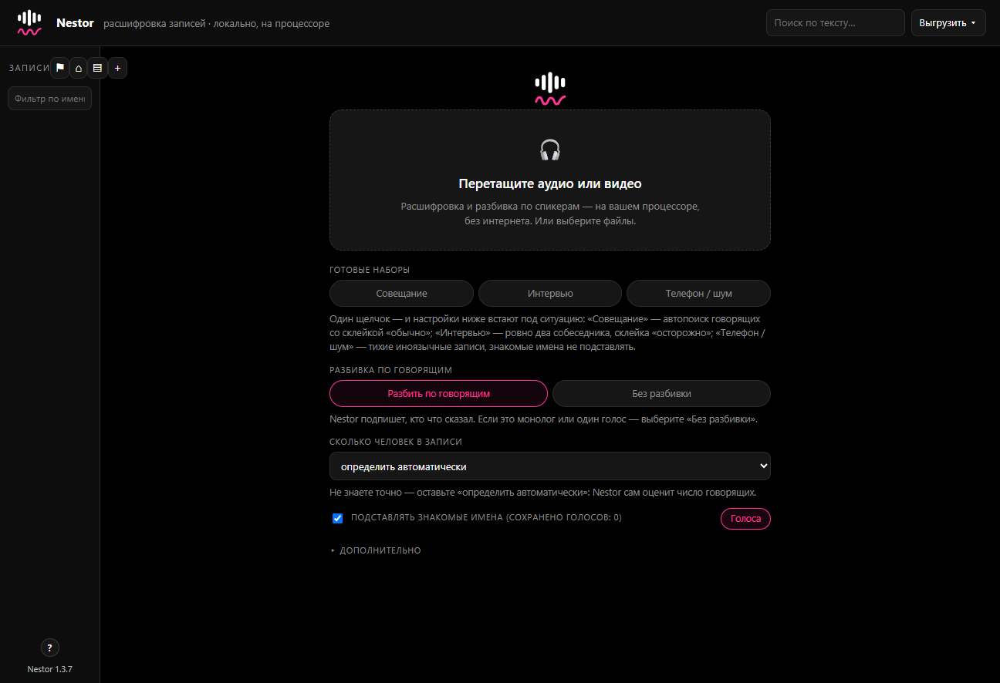
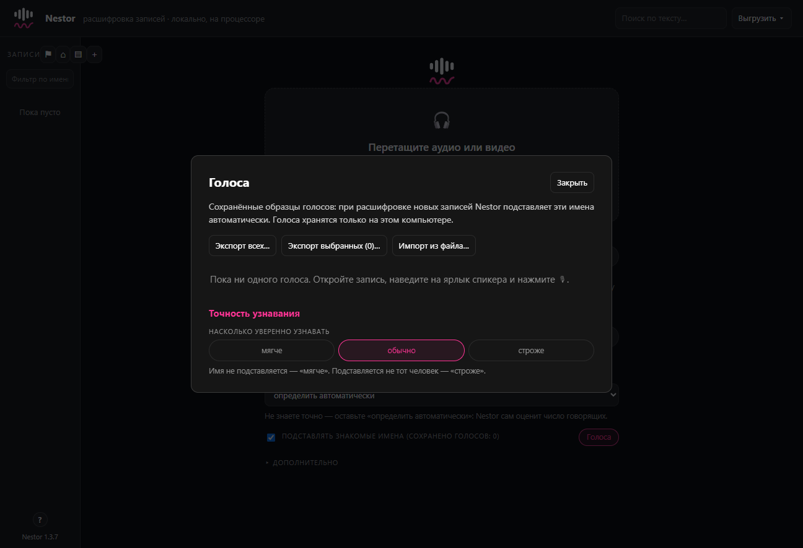

# Nestor

[](https://github.com/AndroDaemon/Nestor/actions/workflows/ci.yml)

Offline **транскрибация + диаризация** речи на CPU. Настольное приложение для Windows и CLI.



* **ASR**: [GigaAM v3](https://github.com/salute-developers/GigaAM) — punct-транcдьюсер ONNX с пунктуацией (sherpa-onnx), русский язык, MIT
* **Диаризация**: [sherpa-onnx](https://github.com/k2-fsa/sherpa-onnx): pyannote-segmentation-3.0 + TitaNet-small, **без токена и без сети**, модели входят в поставку
* Всё работает **локально**, без облака и без GPU.

> Диаризации в самой GigaAM нет — это чистый ASR. Спикеры определяет отдельная
> модель, а текст к спикерам привязывается по word-level таймстемпам
> GigaAM (появились в релизе 2026/04).

## Руководство пользователя

Подробно — в [`docs/rukovodstvo.md`](docs/rukovodstvo.md): как работает
распознавание (модель GigaAM v3 punct), как настройки влияют на результат
и что делать менеджеру проекта — чек-листы, сценарии, частые проблемы.

## История версий

Подробное описание того, что появилось в каждой версии, собрано отдельно:
[`docs/README-releases.md`](docs/README-releases.md). Текущая версия —
**1.5.1**.

---

## Настольное приложение (Windows)

```bash
nestor desktop          # окно приложения
nestor build-exe        # сборка dist\Nestor\Nestor.exe (~8 минут)
```

Готовый exe: `dist\Nestor\Nestor.exe` + папка `dist\Nestor\` (≈1.6 ГБ: PyTorch,
веса GigaAM, модели диаризации). Это onedir-сборка
PyInstaller — exe нельзя отделять от своей папки. Модели лежат внутри
(`_internal\models`), поэтому приложение работает полностью без интернета.
Установщик `Nestor-Setup-1.5.1.exe` ставит приложение
в `%LOCALAPPDATA%\Nestor` без прав администратора.

Окно рисует системный компонент **Microsoft Edge WebView2** (на Windows 10/11 есть
из коробки). Закрыть окно — закрыть программу; второй запуск не создаёт вторую
копию, а поднимает уже открытое окно.

Что умеет:

| | |
|---|---|
| Загрузка | drag&drop в окно или выбор файлов; можно добавлять без старта и запускать позже из меню записи |
| Библиотека | список записей слева: длительность, число спикеров, реплик, статус |
| Редактор | правка текста реплик прямо на экране, переименование спикеров, склейка и разрезание реплик, закладки, поиск с переходом к совпадению, отмена (Ctrl+Z) |
| Плеер | волновая диаграмма с цветными «линейками» спикеров и метками закладок, перемотка кликом по времени или по реплике, скорость, режим «следовать за речью» |
| Голоса | один раз сохраните голос под именем (🎙 у ярлыка спикера) — на следующих записях Nestor узнает его и подставит имя сам; библиотека голосов хранится только на этом компьютере |
| Повторные проходы | правый клик по записи: распознать спикеров заново (текст и правки сохранятся), пере-расшифровать или запустить всё сначала; можно задать точное число спикеров |
| Отмена и удаление | обработка останавливается в любой момент (в том числе во время диаризации), запись удаляется сразу, без ожидания |
| Выгрузка | Word (docx), текст, Markdown, SRT, VTT, JSON — кнопка «Выгрузить» или иконки в доке; файл сохраняется в «Загрузки» и открывается |
| Автосохранение | правки сохраняются сами (во время обработки — только в памяти, на диск после завершения) |
| Помощь | кнопка «?» внизу панели записей: как работает Nestor, приватность, лицензии |
| Горячие клавиши | `Space` — play/pause, `←`/`→` — ±5 с, `Ctrl+F` — поиск, `Ctrl+E` — выгрузка, `Ctrl+Z` — отмена |

Где лежат данные: `%LOCALAPPDATA%\Nestor`

```
uploads\<id>\       исходные файлы
output\<id>\        расшифровки и правки
peaks\<id>.json     волновая диаграмма
embeddings\<id>.npz  голосовые отпечатки записи
voiceprints\        библиотека знакомых голосов
log.txt             журнал работы
```

Удаление записи из приложения удаляет и её расшифровку, и кэш голосовых
отпечатков. Записи, тексты и голоса не покидают компьютер: приложение
не обращается к сети во время работы.

## Возможности (CLI)

* Вход: `mp3`, `wav`, `m4a`, `ogg`, `flac`, ... (декодирование через ffmpeg)
* Выход: `json` (полная структура со словами и таймстемпами), `srt`, `txt`, `md`, `docx`
* Разметка спикеров в каждом формате: `SPEAKER_00` или ваши имена
* Словарь терминов: услышанные «докер», «днс», «айпи адрес» заменяются на канонические `Docker`, `DNS`, `IP-адрес` (офлайн, без влияния на скорость)
* Полностью офлайн после первичной загрузки моделей

## Требования

| Что | Версия |
|---|---|
| Python | ≥ 3.10 (проверено на 3.12) |
| ffmpeg | в PATH (`winget install ffmpeg`) |
| ОЗУ | ~2 ГБ |
| GPU | не нужен |

Актуальная версия приложения: **1.5.1**.

## Установка

```bash
git clone https://github.com/AndroDaemon/Nestor.git && cd Nestor
python -m venv .venv
.venv\Scripts\activate            # Windows
# source .venv/bin/activate       # Linux / macOS

pip install -e .
```

Проверить установленную версию: `nestor --version`.

## Использование

```bash
# базовый прогон
nestor transcribe meeting.mp3

# свои названия спикеров и форматы
nestor transcribe meeting.mp3 --speaker-labels "Иван,Мария" --formats json,srt,docx

# если спикеров ровно два
nestor transcribe interview.wav --num-speakers 2

# без диаризации (быстрее, один спикер)
nestor transcribe podcast.mp3 --no-diarize

# несколько файлов за раз
nestor transcribe *.mp3 -o out/

# исправить термины по словарю (Docker, DNS, IP-адрес, ...)
nestor transcribe meeting.mp3 --glossary

# свой словарь
nestor transcribe meeting.mp3 --glossary --glossary-path my_terms.yaml

# тестовый сэмпл
nestor download-sample
```

Результаты по умолчанию попадают в `out/<имя_файла>.{json,srt,txt,docx}`.

## Проверка диаризации на двух голосах

В репозитории есть генератор диалога на русском (два разных голоса Edge TTS):

```bash
pip install edge-tts
python scripts/make_dialogue_sample.py samples/dialogue.mp3
nestor transcribe samples/dialogue.mp3 --speaker-labels "Дмитрий,Светлана"
```

Ожидаемый результат — реплики чередуются, каждая у своего спикера:

```
[00:00:00,256] Дмитрий: привет
[00:00:01,839] Дмитрий: меня зовут дмитрий
[00:00:08,093] Светлана: здравствуйте дмитрий
[00:00:16,952] Дмитрий: мы хотим запустить приложение для распознавания речи на процессоре
...
```

## Веб-интерфейс

```bash
nestor serve                 # http://127.0.0.1:8000/?token=...
nestor serve --port 8080
```

Локальный сервис на FastAPI: drag&drop аудио, выбор числа спикеров,
прогресс-бар по стадиям (декодирование → диаризация → распознавание),
транскрипт с таймстемпами и цветными метками спикеров, кнопки скачивания
`json/srt/txt/docx`, история заданий. Клик по строке транскрипта — перемотка
плеера на нужный момент.

Веб-интерфейс — главный экран и библиотека голосов:

| Главный экран | Голоса |
| --- | --- |
|  |  |

Сервер всегда слушает **только 127.0.0.1** (loopback недоступен с других
машин) и требует **сеансовый токен**: при запуске печатается готовый адрес
с `?token=...`, страница запоминает токен и дальше ходит с ним (заголовок
`X-Nestor-Token` + HttpOnly-cookie). Запросы без токена и с чужим `Host`
отклоняются с 403 — это исключает обращения от посторонних веб-страниц
(CSRF) и DNS-rebinding. Других слушающих портов и исходящих соединений у
Nestor нет.

Задания выполняются воркером в фоне (по умолчанию один за раз — так быстрее
на слабом CPU). API доступен и напрямую:

```
POST /api/transcribe        # multipart: file, diarize, num_speakers, speaker_labels
GET  /api/jobs/{id}         # статус и прогресс
GET  /api/jobs/{id}/transcript
GET  /api/jobs/{id}/download/{json|srt|txt|docx}
GET  /api/jobs              # история
```

### Модель распознавания

Nestor использует одну модель — `gigaam-v3-punct`: GigaAM v3-трансдьюсер с
пунктуацией в ONNX (sherpa-onnx, int8-энкодер). Текст сразу приходит со знаками
препинания и заглавными буквами, декодирование ~10× быстрее реального времени
(RTF ≈ 0.1, час записи ≈ 6–10 минут). Модель входит в поставку exe; в
dev-режиме скачивается автоматически при первом запуске (`nestor models` —
заранее). Подробности и рекомендации — в
[руководстве пользователя](docs/rukovodstvo.md#2-модель-распознавания).

## Как устроен пайплайн

```
файл (mp3/wav/…)
  │  ffmpeg → 16 kHz mono float32
  ▼
диаризация (sherpa-onnx) → реплики (start, end, speaker)
  │
  │  реплики склеиваются в чанки ≤ 20 c
  ▼
GigaAM v3 punct (ONNX, sherpa-onnx) с word_timestamps → слова с абсолютным временем
  │
  │  каждое слово приписывается спикеру с максимальным перекрытием
  ▼
сегменты (слова одного спикера склеиваются)
  │
  │  словарь терминов (опц.): «докер» → Docker, «днс» → DNS
  ▼
сегменты → экспорт
```

Код: `nestor/pipeline.py` (оркестрация), `nestor/align.py` (чанки и привязка
спикеров), `nestor/asr_onnx.py` (GigaAM punct через sherpa-onnx),
`nestor/diarize.py` (sherpa-onnx), `nestor/glossary.py` (словарь терминов),
`nestor/exporters/` (json/srt/txt/docx),
`nestor/web/` (FastAPI + UI).

### Словарь терминов

Nestor слышит аббревиатуры так, как их произносят: «докер», «днс», «айпи
адрес». С включённым словарём он заменяет такие формы на канонические —
`Docker`, `DNS`, `IP-адрес`. Это чисто текстовая замена по YAML-словарю
(242 термина: разработка, инфраструктура, виртуализация, сотовая связь,
корпоративные системы), полностью офлайн и без влияния на скорость.

```bash
nestor transcribe meeting.mp3 --glossary
```

**Управление словарём в интерфейсе.** Рядом с тумблером «Исправлять термины
по словарю» — кнопка **«Словарь»**. В ней можно:

* **посмотреть** все термины с их вариантами и **искать** по любому из них;
* **добавить** термин (каноническую форму и варианты через запятую) и
  **удалить** ненужный;
* **проверить текст**: вставить фразу и увидеть, что и на что заменится;
* **экспортировать** словарь в YAML-файл и **импортировать** чужой —
  термины из файла вливаются в текущий словарь.

Правки сохраняются в `hotwords.yaml` в каталоге данных
(`%LOCALAPPDATA%\Nestor` на Windows) и вступают в силу сразу, без
перезапуска. Встроенный словарь при этом не трогается — при первом изменении
он копируется в пользовательский файл, и дальше правится только он.

Короткие русские алиасы («днс», «впн») применяются только к словам,
распознанным заглавными буквами, чтобы не портить обычную речь («нас»,
«лак»). Формат файла (его же можно задать через `--glossary-path`):

```yaml
- term: "Docker"
  aliases: ["докер"]
- term: "IP-адрес"
  aliases: ["айпи адрес", "айпи"]
```

## Производительность

Модель GigaAM v3 punct в ONNX декодирует примерно в 10 раз быстрее реального
времени: RTF ≈ 0.1, то есть **час аудио — это около 6–10 минут только на
распознавание** (зависит от CPU). Полный проход с диаризацией и голосами
дороже: часовая запись занимает примерно **15–35 минут** в зависимости от
процессора (RTF 0.28–0.55). Разбивка по стадиям пишется в
`output/<id>/timings.json` и видна в раскрытой карточке записи.

Ускоряет `--threads N` (по умолчанию — все физические ядра, не больше 8).

## Форматы файлов

Принимаются `mp3`, `wav`, `m4a`, `aac`, `ogg`, `opus`, `flac`, `wma`, `aiff`,
`webm`, `mp4`, `mkv`, `mov`, `avi`, `3gp` — декодирование через ffmpeg.
Проверено в том числе на `webm` (Opus) и на видео-контейнерах.

## Отладка интерфейса (без сборки exe)

```bash
nestor desktop      # окно приложения из исходников — правки в UI видны сразу
nestor serve        # тот же интерфейс в браузере: http://127.0.0.1:8000
```

Правки в `nestor/web/static/index.html` подхватываются при перезагрузке окна
(Ctrl+R) или страницы браузера — пересборка exe не нужна.

## Разработка

```bash
pip install -e ".[dev]"
pytest -q
```

Тесты покрывают логику разбиения на чанки, привязки слов к спикерам и
экспорт в JSON/SRT/TXT (без тяжёлых зависимостей).

## Лицензии

Код Nestor распространяется под лицензией **MIT** — полный текст и список
сторонних компонентов в файле [LICENSE](LICENSE).

Модели, рантаймы и библиотеки, входящие в поставку приложения:

| Компонент | Назначение | Лицензия |
|---|---|---|
| [GigaAM v3](https://github.com/salute-developers/GigaAM) | распознавание русской речи | MIT |
| [sherpa-onnx](https://github.com/k2-fsa/sherpa-onnx) | рантайм ASR и диаризации | Apache-2.0 |
| [pyannote/segmentation-3.0](https://huggingface.co/pyannote/segmentation-3.0) | сегментация говорящих | MIT |
| [NVIDIA TitaNet (small)](https://huggingface.co/nvidia/speakerverification_en_titanet_large) | голосовые отпечатки | CC-BY-4.0 |
| FastAPI, Starlette, Uvicorn, Pydantic | веб-интерфейс | MIT / BSD |
| pywebview, Microsoft Edge WebView2 | окно приложения | BSD-3-Clause / Microsoft |
| PyTorch, Torchaudio | вычисления | BSD-3-Clause |
| FFmpeg | декодирование аудио (внешний процесс) | LGPL / GPL |
| NumPy, SciPy, python-docx, SentencePiece, ONNX Runtime | — | свободные лицензии |

Сами веса моделей не входят в git-репозиторий: они либо скачиваются при
первом запуске из dev-режима, либо пакуются в установщик. Атрибуция моделей
(NVIDIA, pyannote, GigaAM) приведена здесь и в разделе «Помощь» приложения.
