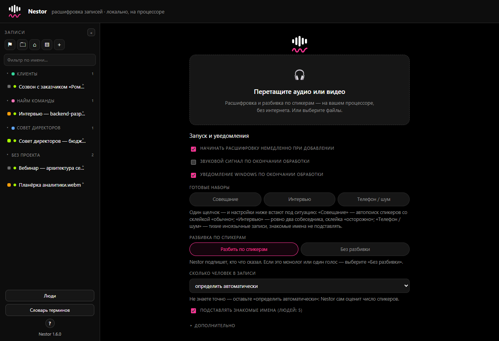
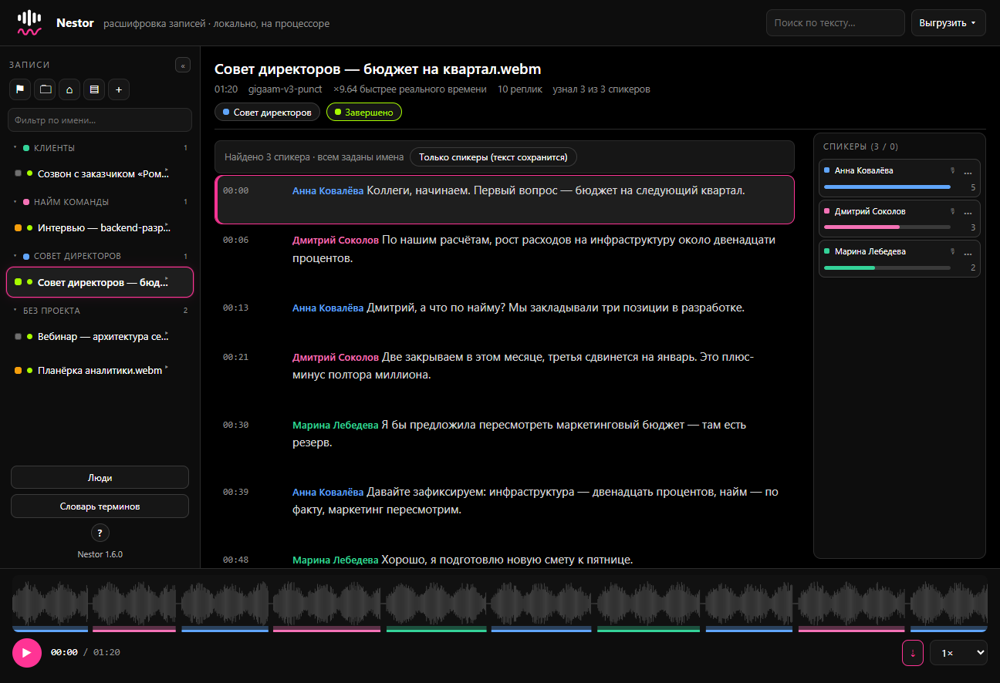
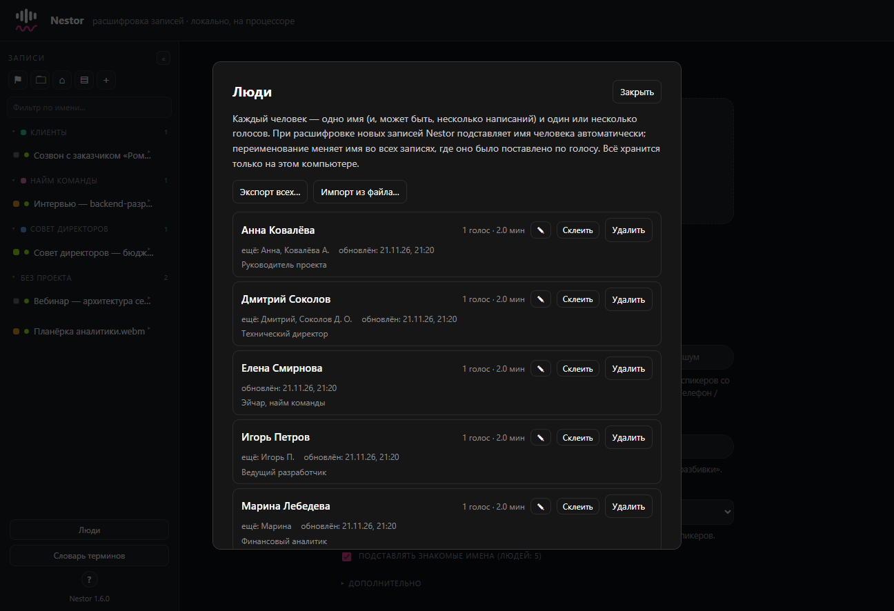
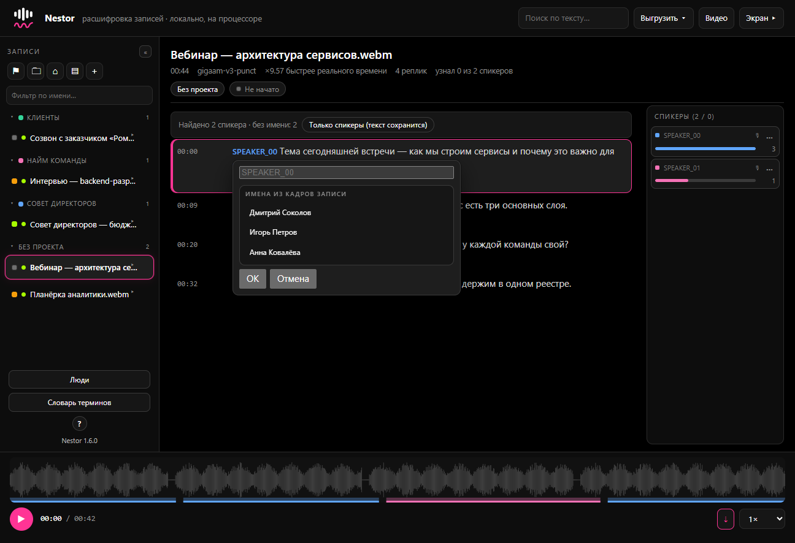
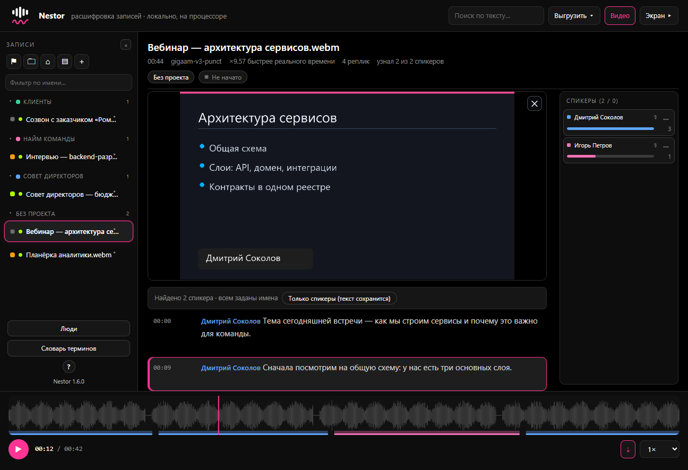
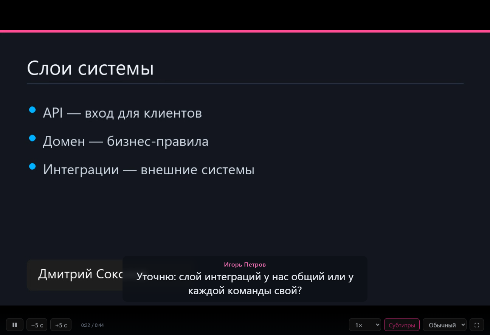
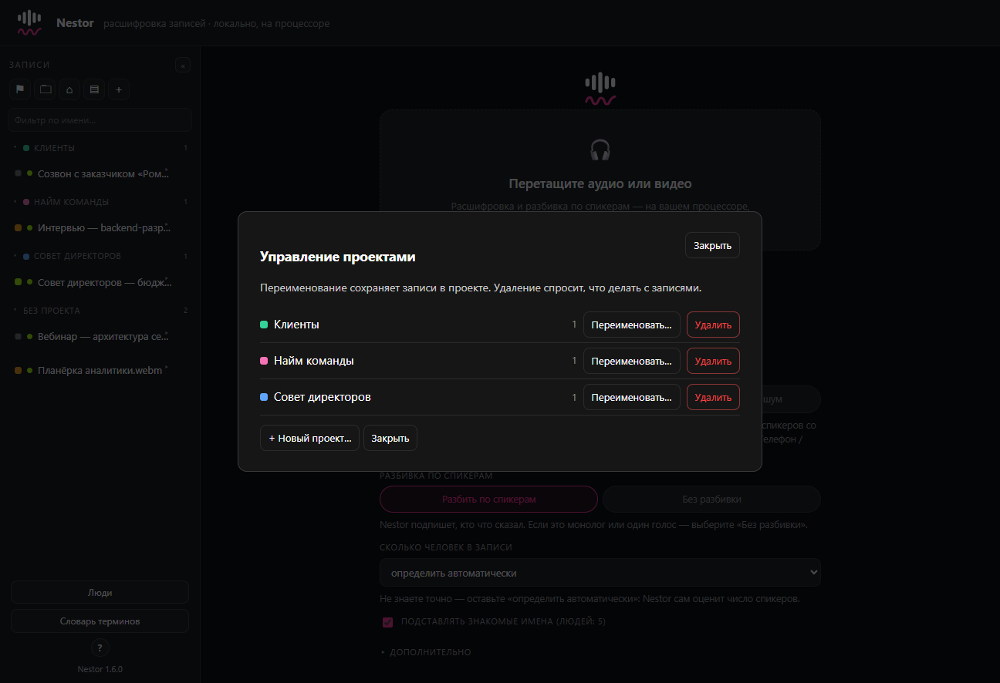
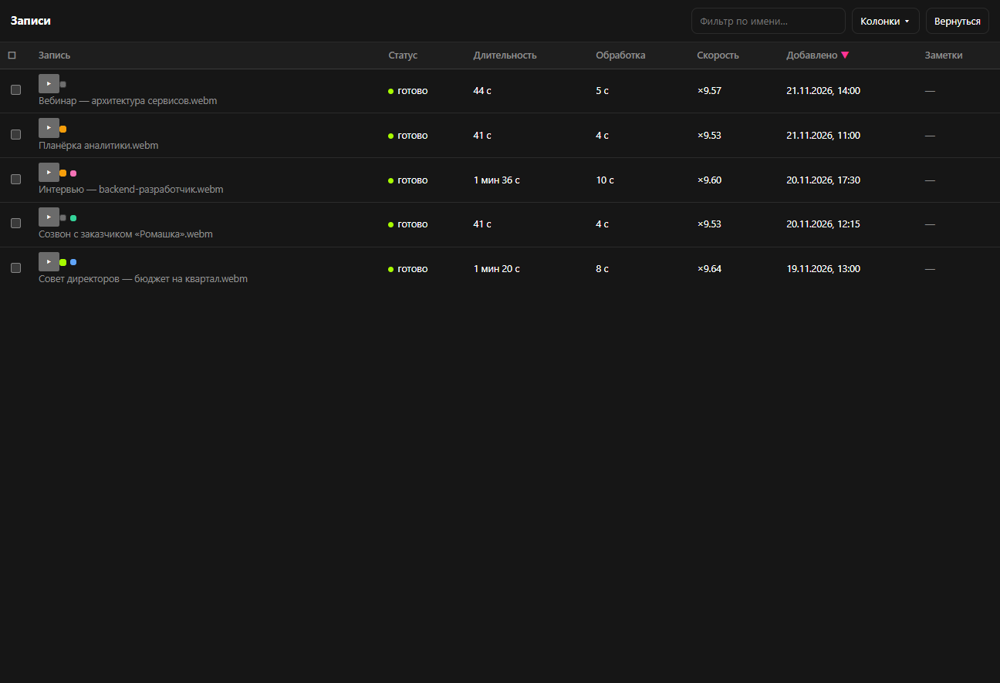

# Nestor: офлайн-транскрибация и диаризация на CPU — от идеи до особенностей реализации

*Расшифровка встреч без облака, без GPU и без отправки чужих голосов наружу. Как устроено настольное приложение, которое разбирает час записи за 15–35 минут на ноутбучном процессоре, почему в нём три разные нейросети и одна неочевидная текстовая замена.*

---

## Коротко для тех, кто не хочет читать целиком

**Nestor** — открытое (MIT) настольное приложение и CLI для Windows, которое расшифровывает русскую речь и разбивает текст по спикерам **полностью локально**, на обычном процессоре. Внутри три нейросети: распознавание речи (GigaAM v3 punct, ONNX), сегментация говорящих (pyannote-segmentation-3.0) и голосовые отпечатки (TitaNet-small). Никакого облака, токенов и GPU; модели входят в поставку установщика. Час аудио — около 6–10 минут только на распознавание и 15–35 минут на полный проход со спикерами, в зависимости от CPU.

Ссылки: репозиторий — [github.com/AndroDaemon/Nestor](https://github.com/AndroDaemon/Nestor), установщик и исходники — в разделе релизов, новости — [@Nestor_transcribe](https://t.me/Nestor_transcribe).

---

## Зачем это понадобилось

Задача звучит буднично: «получить текст встречи с разделением по голосам». По рынку таких сервисов много, но у всех облачных вариантов есть общий недостаток — запись уходит на чужой сервер. В корпоративной и юридической практике это часто стоп-фактор: не всегда можно отправить наружу запись разговора с клиентом, кандидатом на собеседовании или сотрудником.

Плюс есть чисто бытовые требования:

* **Русский язык** и живая речь с пунктуацией, а не поток слов.
* **Работа на ноутбуке** без дискретной видеокарты — у большинства менеджеров и аналитиков её просто нет.
* **Понятный интерфейс**, а не командная строка, потому что пользователь — не программист.
* **Никаких регистраций и токенов** — открыл и работаешь.

Отсюда и сформировался профиль проекта: офлайн, CPU, Windows, настольное приложение с веб-технологиями внутри.

---

## Что такое Nestor на практике

Приложение ставится в `%LOCALAPPDATA%\Nestor` без прав администратора. Окно — это нативный хост (pywebview + Microsoft Edge WebView2, который есть в Windows 10/11 из коробки), внутри которого работает локальный FastAPI-сервер и обычный веб-интерфейс. Есть и чистый CLI — `nestor transcribe meeting.mp3`.

Что умеет интерфейс:

| Раздел | Что делает |
|---|---|
| Библиотека | список записей с длительностью, числом спикеров и реплик, статусом обработки |
| Редактор | правка текста прямо в реплике, переименование спикеров, склейка и разрезание реплик, закладки, поиск, отмена (Ctrl+Z) |
| Плеер | волновая диаграмма с цветными «линейками» спикеров, перемотка кликом по времени или реплике, скорость, режим «следовать за речью» |
| Люди | библиотека голосов: один раз сохранили голос под именем — на следующих записях Nestor узнаёт его сам |
| Видео | панель видео над расшифровкой и отдельное окно «Экран докладчика» с субтитрами на втором мониторе |
| Имена из видео | OCR читает подписи участников с кадров и подсказывает их при разметке |
| Проекты | группировка записей по темам и состояние разбора: «не начато / в работе / завершено» |
| Выгрузка | Word (docx), текст, Markdown, SRT, VTT, JSON; копирование в буфер с таймстемпами |

Хранилище — только этот компьютер: исходники в `uploads\`, расшифровки в `output\`, голосовые отпечатки в `embeddings\` и `voiceprints\`, волны в `peaks\`, журнал в `log.txt`. Приложение во время работы не обращается к сети.



*Главный экран: сюда перетаскивается запись, рядом — готовые наборы и настройки.*



*Разбор записи: слева — записи, сгруппированные по проектам; в центре — расшифровка с цветными именами спикеров; справа — панель спикеров; внизу — волна и плеер.*

---

## Архитектура конвейера

Пайплайн собран из независимых шагов, и это принципиально: **распознавание речи и определение спикеров — разные модели**. Невнятную речь не исправят настройки спикеров, а ошибку диаризации не исправит более точная ASR.

```
аудио/видео (mp3, wav, webm, mp4, …)
  │  ffmpeg → 16 кГц mono float32
  ▼
диаризация (sherpa-onnx) → реплики (start, end, speaker)
  │  реплики склеиваются в чанки ≤ 20 с
  ▼
GigaAM v3 punct (ONNX, sherpa-onnx) с word_timestamps → слова с абсолютным временем
  │  каждое слово приписывается спикеру с максимальным перекрытием
  ▼
сегменты (слова одного спикера склеиваются)
  │  знакомые голоса: сравнение отпечатков кластеров с библиотекой
  │  (опц.) словарь терминов: «докер» → Docker, «днс» → DNS
  ▼
экспорт
```

Ключевые модули: `pipeline.py` (оркестрация), `align.py` (чанки и привязка слов к спикерам), `asr_onnx.py` (GigaAM), `diarize_local.py` (sherpa-onnx), `speaker_embed.py` (отпечатки), `speaker_match.py` (правило узнавания), `glossary.py` (словарь), `exporters/`, `web/`.

Обратите внимание на порядок: **сначала диаризация, потом распознавание**. Это даёт важное свойство — чанки для ASR нарезаются уже по границам речи, а не вслепую по равным интервалам. Модель не тратит время на тишину и не «перескакивает» между говорящими в одном куске.

### Распознавание речи: GigaAM v3 punct

ASR — это `gigaam-v3-punct`: русский трансдьюсер GigaAM v3 с пунктуацией, сконвертированный в ONNX и запускаемый через sherpa-onnx (int8-энкодер). Текст сразу приходит со знаками препинания и заглавными буквами.

Несколько инженерных деталей, которые пришлось учесть:

* Модель создаётся с `model_type="nemo_transducer"` — обычный загрузчик трансдьюсера читает `vocab_size`/`context_size` из метаданных декодера, а у этой модели они лежат в энкодере.
* GigaAM отдаёт **word-level таймстемпы** (появились в релизе 2026/04) — именно на них держится привязка слов к спикерам. Без них получилось бы заметно хуже.
* Токены SentencePiece склеиваются в слова: токен, начинающийся с маркера слова (`▁` или пробел) — новое слово, токен без маркера (пунктуация) дописывается к текущему. Словам даётся небольшой `WORD_END_PAD` (0.12 с), чтобы соседние слова не наезжали друг на друга в экспортах.

Скорость: RTF ≈ 0.1, то есть час аудио — около 6–10 минут только на распознавание.

### Диаризация: pyannote + TitaNet, без токена

Диаризация отвечает на вопрос «кто когда говорил». Здесь используется связка из двух публичных ONNX-моделей:

* `pyannote-segmentation-3.0` — сегментация говорящих (кто говорит в каждый момент);
* `nemo_en_titanet_small.onnx` — голосовые эмбеддинги (192-мерные L2-нормализованные векторы).

Принципиальный момент: **и то, и другое входит в поставку и работает без сети и без токена Hugging Face**. Многие рецепты диаризации требуют принять лицензию и получить токен — здесь этого нет, что для офлайн-приложения критично.

Дальше кластеры (однородные по голосу группы реплик) нумеруются как `SPEAKER_00`, `SPEAKER_01` и т. д. — **по первому появлению в записи**, а не по «сырым» id диаризатора (те бывают вида 0, 71, 296 и пугают пользователя).

### Привязка слов к спикерам

Это функция `assign_speakers` из `align.py`. Каждое слово «получает» спикера с максимальным временным перекрытием. Слова, которые ASR услышал, а диаризация пропустила (например, короткая ремарка на границе), приписываются **ближайшей по времени** реплике — так не теряется текст.

Затем слова одного спикера склеиваются в реплики-сегменты. Здесь есть ограничение на длину сегмента (60 с): без него непрерывный монолог превратился бы в абзац на несколько минут — нечитаемо в расшифровке и непригодно для модели отпечатков, которая отвергает слишком длинные фрагменты (свыше ~123 с).

---

## Особенности, о которых стоит рассказать отдельно

### 1. Знакомые голоса и «Люди»

Это, пожалуй, самая полезная функция и самая нетривиальная. Идея простая: вы один раз сохранили голос человека под именем — и на следующих записях Nestor подставляет имя сам.

Как хранится: отпечаток — это вектор float32 (dim 192, L2-нормализован) в `voiceprints\<slug>.npy`, метаданные — в JSON. Slug — транслитерация имени («Иван Петров» → `ivan-petrov`), коллизии разрешаются суффиксом. Запись атомарная (tmp + `os.replace` с ретраями). Повторное «запоминание» того же имени **усредняет вектор по длительности**, а не затирает — портрет постепенно становится точнее.

Правило узнавания («правило трёх») — намеренно строгое, чтобы не путать людей. Имя присваивается, только если выполнены **все три** условия:

1. косинусная близость к лучшему отпечатку ≥ **0.75**;
2. отрыв от второго кандидата ≥ **0.05** (никаких «ничьих»);
3. ≥ **60 %** сегментов кластера голосуют за того же победителя (короткие сегменты < 0.5 с не голосуют).

Не прошло — ярлык остаётся `SPEAKER_NN`. Никаких догадок. Один отпечаток не может быть присвоен двум кластерам в одном прогоне.

**Робастное ядро портрета.** Наивное «среднее всех реплик» портится от случайного шума и чужого голоса. Поэтому Nestor считает черновой центроид, отбрасывает выбросы и берёт среднее по «ядру» — ближайшим к центроиду репликам (около 70 %, но не меньше двух реплик). Если пользователь выделил реплики-образцы вручную и нажал 🎙, портрет строится **только по ним** и без автоматического отсева: выбор человека считается доверенным.

В версии 1.6.0 над библиотекой голосов появился слой **«Люди»**. Раньше сущностью был отдельный отпечаток; теперь — человек: одно отображаемое имя, несколько написаний (алиасы), все его голоса и заметка. Инвариант: **один голос принадлежит ровно одному человеку**. Переименование человека обновляет имя во всех записях, где оно подставилось по голосу, но **не трогает ручные правки**. При вводе имени интерфейс предлагает «Похоже, это …» — так «Иванов Иван» и «Иванов Иван Петрович» схлопываются в одного человека. Людей можно склеивать, переносить между ними голоса и оставлять заметки.



*Реестр «Люди»: у каждого человека — имя, роль, написания-алиасы, привязанные голоса и точность узнавания.*

### 2. Восстановление пропусков без лишней работы

Первое, что бросается в глаза при работе с реальными записями: ASR местами «теряет» тихую речь — отошёл человек от микрофона, проговорил на вдохе. Nestor делает второй «спасательный» проход по пропускам, но не по всем подряд:

* в повторную расшифровку попадают паузы длиной **2–20 с** (короче — это обычная пауза, длиннее — настоящая тишина);
* фрагмент перерасшифровывается, только если в нём **слышно что-то громче шумового пола** комнаты. Порог намеренно щедрый: тихий участник, отошедший от микрофона, его проходит, а дыхание и шелест бумаги — нет.

Замеры на часовых записях показали, что самый громкий 20-миллисекундный кадр каждой «дырки» сидит на 6–20 дБ выше собственного шумового пола комнаты, и именно этот пол первая стадия оставляет незанятым. Гейт по шумовому полу отсекает от 0 до 20 % лишних перерасшифровок, не теряя тихую речь.

### 3. Память и многочасовые записи

Самый неприятный класс багов для десктопного приложения — падение на длинных файлах. Пятичасовые записи когда-то заканчивались ошибкой `bad allocation`: в памяти оказывалось несколько полных копий волны.

Что сделано:

* **Подготовка звука без многогигабайтных копий.** Декодированный звук пишется в `audio16k.wav` блоками по ходу декодирования, а не склеивается из сотен тысяч кусков в памяти.
* **Диаризация перекрывающимися блоками** по 20 минут с сшивкой ярлыков спикеров между блоками (метки сопоставляются по косинусной близости центроидов). Пик памяти упал с ≈6 ГБ до ≈1.2–1.8 ГБ.
* **Пропуск цифровой тишины.** Блок тише −70 dBFS не содержит речи: длинные записи с «молчащим» диктофоном больше не гоняются через модель, и pyannote не читает шумовой пол как спикера.

### 4. Дочерние процессы: «окно не замирает»

Декодирование и диаризация — самые тяжёлые и «залипающие» стадии. Они выполняются в **отдельных процессах** с пониженным приоритетом. Это решает две задачи: интерфейс остаётся живым с первой секунды (раньше окно подвисало на десятки секунд, пока шёл декод), а зависшую тяжёлую стадию можно прервать, не убивая всё приложение. Если дочерний процесс не справился, родитель аккуратно откатывается на выполнение «в себе».

Есть при этом и защита от потери работы: если закрыть окно во время обработки, Nestor сначала спросит подтверждение и только потом остановит задания (а события окна и необработанные исключения пишутся в `ui.log` — на случай, если окно всё-таки «пропало»).

### 5. Экономия потоков: почему у диаризации отдельный бюджет

Тут неочевидный, но важный момент. Разные стадии по-разному реагируют на число потоков:

* **ASR** выигрывает от нескольких ядер, но не бесконечно: авто-режим ставит физические ядра, **не больше 8** — дальше ONNX Runtime почти не ускоряется, а 15-ваттный ноутбук начинает троттлить.
* **Диаризация** использует агломеративную кластеризацию, квадратичную по числу речевых сегментов: больше потоков делают стадию **медленнее**. Замеры на часовом аудио: 4 потока обогнали 8 (28.4 с против 33.1 с на 300-секундном срезе и 44.5 с против 72.0 с на загруженной машине). Поэтому у диаризации **свой фиксированный бюджет — 4 потока**.

Отдельно — гибридные процессоры Intel (P-ядра + E-ядра): тяжёлый воркер удерживается на производительных ядрах, при желании поднимается приоритет процесса. На не-Windows и без нужных данных всё это аккуратно вырождается в «ничего не делаем».

### 6. Словарь терминов

Модель слышит аббревиатуры так, как их произносят: «докер», «днс», «айпи адрес». Nestor с включённым словарём заменяет такие формы на канонические — `Docker`, `DNS`, `IP-адрес`. Это **чисто текстовая замена** по YAML-словарю (242 термина: разработка, инфраструктура, виртуализация, сотовая связь, корпоративные системы), полностью офлайн и без влияния на скорость.

Тонкость: короткие русские алиасы («днс», «впн») применяются только к словам, распознанным заглавными буквами, — чтобы не портить обычную речь («нас», «лак»). Словарь правится прямо в интерфейсе и хранится в `hotwords.yaml`; встроенный при этом не трогается — при первом изменении он копируется в пользовательский файл.

### 7. Видео и имена из кадров

У записей с картинкой появляются два режима: панель видео над расшифровкой и отдельное окно **«Экран докладчика»** с крупным видео и субтитрами (удобно на втором мониторе). Режимы взаимоисключающие; звук всегда в главном окне (видео без звука — нет эха), управление общее, синхронизация — через `BroadcastChannel`. Есть кнопка «Поверх», удерживающая окно над другими программами.

Отдельная любопытная часть — **чтение имён участников с кадров видео**. Это не «кто когда говорит», а именно ростер: Nestor читает подписи на плашках участников и подсказывает их при разметке спикеров.

OCR пришлось написать свой: в замороженной сборке нет OpenCV и SciPy, поэтому движок собран из `onnxruntime` + `numpy` + `Pillow`, а связные компоненты реализованы небольшим union-find. Используются две модели PaddleOCR: детектор `PP-OCRv5_mobile_det` и кириллический распознаватель `cyrillic_PP-OCRv5_mobile_rec`. Это **не универсальный OCR** — он рассчитан на короткие высококонтрастные строки вроде плашек участников видеоконференции. Модели занимают ≈13 МБ и необязательны.



*При переименовании спикера Nestor предлагает имена, прочитанные OCR с кадров видео.*

Плюс есть **копирование расшифровки с таймстемпами**: строки вида `[00:12:34,120] Имя: текст`.



*Видео-панель закреплена над текстом — удобно листать расшифровку, не теряя картинку.*



*Окно «Экран докладчика» для второго монитора: крупное видео и субтитры поверх него.*

### 8. Проекты и состояние разбора

При большом количестве длинных файлов хочется понимать, что к чему относится и что уже сделано. Отсюда два независимых механизма:

* **Проекты** — группировка по теме, как папки, но одна запись лежит ровно в одном проекте. В панели слева проекты показаны сворачиваемыми секциями, назначение — из меню записи, массово из таблицы, переименование сохраняет записи, удаление проекта не теряет их («Без проекта»).
* **Состояние разбора** — отдельная от статуса обработки ось: «Не начато» (серый) / **«В работе» (янтарный, ставится сам при правке реплик или спикеров)** / «Завершено» (лаймовый, вручную). Правка уже завершённой записи автоматически возвращает её в «В работе».

Важно, что «в работе» — **не ручная отметка**: она появляется сама, как только вы что-то поправили. Это и была цель — не помнить, где вы остановились.



*Проекты — это «папки» для тем: управление — переименование и удаление с сохранением записей.*



*Режим таблицы: все записи столбцами — статус, длительность, время и скорость обработки.*

---

## Безопасность и приватность

Приложение принципиально офлайн, и это отражено в коде:

* Сервер слушает **только 127.0.0.1** (loopback недоступен с других машин) и требует **сеансовый токен**: при запуске печатается готовый адрес с `?token=…`, страница запоминает токен (заголовок `X-Nestor-Token` + HttpOnly-cookie).
* Запросы без токена и с чужим `Host` отклоняются с 403 — это закрывает CSRF и DNS-rebinding.
* Других слушающих портов и исходящих соединений у Nestor нет.
* Второй запуск не создаёт вторую копию, а поднимает уже открытое окно (named mutex).

---

## Поставка: как всё это собирается в один exe

Приложение ставится как onedir-сборка PyInstaller: `Nestor.exe` + папка с зависимостями и моделями (≈523 МБ на диске; установщик Inno Setup — около 289 МБ). Модели лежат **внутри** (`_internal\models`), поэтому после установки приложение работает без интернета. Версия берётся из `pyproject.toml` — единый источник и для приложения, и для установщика.

Интересная деталь для тех, кто будет собирать сам: spec ищет модели в каталоге данных (`%LOCALAPPDATA%\Nestor\models`). Если этой папки нет, сборка молча проходит **без моделей** и весит вдвое меньше — приложение потом не сможет работать. Это стоило нам отдельной отладки.

---

## Тесты и качество

Проект покрыт тестами (`pytest`): логика нарезки на чанки, привязки слов к спикерам, экспорт в JSON/SRT/TXT, веб-API, реестр людей, проекты и состояние разбора, видео-пробинг и OCR-логика. Тяжёлые зависимости в тестах не используются — они гоняются на чистой логике и на API-клиенте. На момент версии 1.6.0 — **404 passed, 1 skipped**.

---

## Компромиссы и честные ограничения

* **Формат видео.** Встроенный плеер (WebView2/Chromium) уверенно показывает `.webm`, `.mp4`, `.mov`; `.mkv` и `.avi` могут не открыться — в этом случае панель честно сообщает об этом, а звук и расшифровка работают как обычно.
* **Качество зависит от записи.** Если спикеры говорят одновременно (перебивают друг друга) или микрофон один на всех в шумной комнате, диаризация ошибается — это ограничение самой задачи, а не конкретной модели.
* **Русский язык.** ASR заточен под GigaAM v3 punct; для других языков нужна другая модель. Диаризация и отпечатки — языконезависимые.
* **CPU.** GPU не поддерживается сознательно: цель — работать там, где дискретной видеокарты нет.
* **Дисциплина умалчивания.** Там, где уверенности нет, Nestor молчит: не дотянул голос до порога — оставляет `SPEAKER_NN`, а не угадывает имя.

---

## Итоги

Nestor — пример того, как из «неудобно отправлять запись в облако» вырастает довольно плотное приложение: три нейросети, свой OCR, свой реестр «людей», обработка часовых записей на ноутбуке, живой интерфейс и полная автономность. Главные решения — **диаризация перед распознаванием**, **строгое правило узнавания голосов** и **честное молчание вместо догадок** — оказались и самыми правильными.

Проект открытый (лицензия MIT). Код, документация и руководство пользователя — в репозитории; готовый установщик — в релизах. Если тема интересна, в следующих материалах можно подробнее разобрать внутренности OCR или пайплайн отпечатков голоса.

*Репозиторий: [github.com/AndroDaemon/Nestor](https://github.com/AndroDaemon/Nestor). Канал с новостями версий: [@Nestor_transcribe](https://t.me/Nestor_transcribe).*
